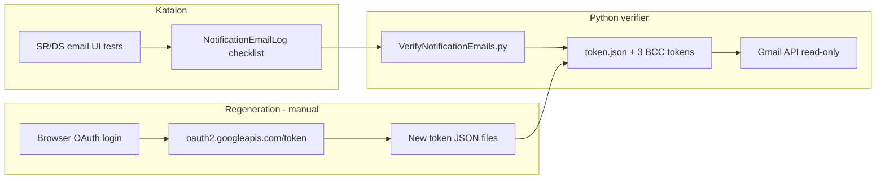

# Gmail OAuth tokens — regenerate and replace

Use this guide when **VerifyNotificationEmails** fails before it searches mail, or when Gmail API refresh stops working. Katalon UI email tests only **log** expected rows; Python **reads** Gmail using four local token files. Those files are **not** in git.

## What the tokens are for

| Token file (in this folder) | Mailbox you sign in as | Used for checklist rows |
|----------------------------|-------------------------|-------------------------|
| `token.json` | `qa@essential-soft.com` | **To** (and qa+ aliases on CRDC_QA) |
| `token-fedlead-bcc.json` | `pbac.fedlead@gmail.com` | **Bcc** / **Cc** for Fedlead (`FedleadBccEmail`, `FedleadCc`) |
| `token-dcp-bcc.json` | `vincentnihtestfour@gmail.com` | **Bcc** for DCP (`DcpBccEmail` on CRDC_QA) |
| `token-admin-bcc.json` | `pbacmaster@gmail.com` | **Bcc** / **Cc** for Admin (`AdminBccEmail`, `AdminCc`) |

Profile globals live in `Profiles/CRDC_QA.glbl` (`FedleadBccEmail`, `DcpBccEmail`, `AdminBccEmail`, etc.).

`VerifyNotificationEmails.py` only uses **`gmail.readonly`**. It does **not** open a browser. It loads each token JSON, refreshes the short-lived access token with the stored **refresh_token**, then queries Gmail.

## End-to-end flow



1. Run email notification UI tests → checklist rows in the notification Excel log.
2. Run **VerifyNotificationEmails** → Python reads Gmail with the four token files.
3. When refresh fails → regenerate tokens (this guide) → copy JSON into `PythonFiles/CRDC/gmail/` → run Verify again.

## When you need to regenerate

### Symptom A: `invalid_grant` / Token has been expired or revoked

Example in Katalon log:

```text
google.auth.exceptions.RefreshError: ('invalid_grant: Token has been expired or revoked.', ...)
```

Often happens in `load_bcc_services` or `load_creds` at the start of `VerifyNotificationEmails.py`.

**Meaning:** The **refresh_token** in one or more JSON files is no longer valid (idle OAuth app in Testing mode, access revoked in Google Account, password/security change, stale copy from a teammate, OAuth client rotated in Cloud Console).

**Fix:** Re-run the browser OAuth flow for **each affected mailbox** (see below). You can regenerate all four at once to avoid chasing the next failure.

### Symptom B: Browser works, Python dies on `oauth2.googleapis.com`

Example:

```text
ConnectionError: HTTPSConnectionPool(host='oauth2.googleapis.com', port=443): ... Connection refused
```

**Meaning:** Google accepted login in the browser, but Python could not **exchange** the auth code for tokens (step 2 of OAuth). Common on **NIH VPN** or corporate proxy: Chrome works; Terminal Python does not.

**Fix:**

- Disconnect VPN and retry, **or**
- Set `HTTPS_PROXY` / `HTTP_PROXY` if IT requires a proxy (keep `NO_PROXY=localhost,127.0.0.1` for the local redirect).

Quick check in the same terminal:

```bash
curl -sS -o /dev/null -w "%{http_code}\n" --connect-timeout 10 https://oauth2.googleapis.com/token
```

You should get an HTTP response (e.g. `404` or `405`), not connection refused.

### Symptom C: `access_denied` in the browser

Add each Gmail account under **Google Cloud Console → APIs & Services → OAuth consent screen → Test users**. Every inbox that logs in must be listed. Scope must include `https://www.googleapis.com/auth/gmail.readonly`.

## Prerequisites

### 1. OAuth client JSON (credentials)

The team keeps Desktop OAuth client downloads **outside** this repo, typically in a folder such as `~/gmail-oauth`:

| Credentials file | Sign in as |
|------------------|------------|
| `credentials-qa-esi.json` | `qa@essential-soft.com` |
| `credentials-fedlead.json` | `pbac.fedlead@gmail.com` |
| `credentials-dcp.json` | `vincentnihtestfour@gmail.com` |
| `credentials-admin.json` | `pbacmaster@gmail.com` |

Ask a teammate for these four files if you do not have them. **Do not commit** credentials or tokens.

First-time GCP setup (new project or client): see **One-time: enable Gmail API and create tokens** in [README.md](./README.md).

### 2. Python venv in `gmail-oauth`

```bash
cd ~/gmail-oauth
python3 -m venv .venv
source .venv/bin/activate
pip install google-auth-oauthlib google-api-python-client
```

(If `.venv` already exists, only `source .venv/bin/activate`.)

### 3. Network

Prefer **off VPN** for the four OAuth runs unless you know proxy env vars are set.

## Regenerate all four tokens (copy-paste)

Run from `~/gmail-oauth` with venv active (`source .venv/bin/activate`).

Each command writes the **same filename** the Katalon project uses (`token.json` and the three `token-*-bcc.json` files), so install is a straight copy.

### How to run each command (do this four times, one mailbox at a time)

Do **not** paste all four Python blocks into the terminal at once. Work through the list below **in order**, one block per mailbox:

1. **Paste and run a single command** from the next section (only that mailbox’s `python3 -c "..."` block). Press Enter once.
2. The terminal prints `Please visit this URL to authorize...` and usually **opens your default browser**. If it does not, copy the URL from the terminal into the browser.
3. **Sign in with the Gmail account named in the heading** for that command (see table). If Chrome is already logged in as someone else, choose **Use another account** and enter the correct address and password.
4. On **“Google hasn’t verified this app”** (Testing OAuth app), click **Advanced** → **Go to … (unsafe)** or **Continue** — expected for the team helper project.
5. On the permission screen, confirm the app requests **View your email messages and settings** (read-only). Click **Continue**, **Allow**, or **Select all** → **Continue** until Google finishes.
6. The browser should show a short **“The authentication flow has completed”** (or similar) page. Return to the terminal: it must print **`Wrote token.json`** or **`Wrote token-…-bcc.json`** with **no traceback**. Wait until you get your shell prompt back.
7. **Only then** run the **next** mailbox’s command. Repeat steps 1–6 until all four files exist in `~/gmail-oauth`.

| Step | Run this command block | Sign in to Google as |
|------|------------------------|----------------------|
| 1 | Main To mailbox | `qa@essential-soft.com` |
| 2 | Fedlead BCC | `pbac.fedlead@gmail.com` |
| 3 | DCP BCC | `vincentnihtestfour@gmail.com` |
| 4 | Admin BCC | `pbacmaster@gmail.com` |

If you pick the wrong Google account, the token file will authorize the wrong inbox — delete that JSON in `~/gmail-oauth` and rerun that step with the correct login.

---

**1 — Main To mailbox (`qa@essential-soft.com`):**

```bash
python3 -c "
from google_auth_oauthlib.flow import InstalledAppFlow
SCOPES = ['https://www.googleapis.com/auth/gmail.readonly']
flow = InstalledAppFlow.from_client_secrets_file('credentials-qa-esi.json', SCOPES)
creds = flow.run_local_server(port=0)
open('token.json', 'w').write(creds.to_json())
print('Wrote token.json')
"
```

**2 — Fedlead BCC (`pbac.fedlead@gmail.com`):**

```bash
python3 -c "
from google_auth_oauthlib.flow import InstalledAppFlow
SCOPES = ['https://www.googleapis.com/auth/gmail.readonly']
flow = InstalledAppFlow.from_client_secrets_file('credentials-fedlead.json', SCOPES)
creds = flow.run_local_server(port=0)
open('token-fedlead-bcc.json', 'w').write(creds.to_json())
print('Wrote token-fedlead-bcc.json')
"
```

**3 — DCP BCC (`vincentnihtestfour@gmail.com`):**

```bash
python3 -c "
from google_auth_oauthlib.flow import InstalledAppFlow
SCOPES = ['https://www.googleapis.com/auth/gmail.readonly']
flow = InstalledAppFlow.from_client_secrets_file('credentials-dcp.json', SCOPES)
creds = flow.run_local_server(port=0)
open('token-dcp-bcc.json', 'w').write(creds.to_json())
print('Wrote token-dcp-bcc.json')
"
```

**4 — Admin BCC (`pbacmaster@gmail.com`):**

```bash
python3 -c "
from google_auth_oauthlib.flow import InstalledAppFlow
SCOPES = ['https://www.googleapis.com/auth/gmail.readonly']
flow = InstalledAppFlow.from_client_secrets_file('credentials-admin.json', SCOPES)
creds = flow.run_local_server(port=0)
open('token-admin-bcc.json', 'w').write(creds.to_json())
print('Wrote token-admin-bcc.json')
"
```

Each run should print `Wrote ...` and **not** traceback. If the exchange fails after you clicked Allow, fix network (VPN) and run **that mailbox again** (auth codes are one-time).

### Missing `refresh_token` in the new JSON

Google may omit a new refresh token if the app was already authorized. For that account: **Google Account → Security → Third-party access** → remove the CRDC / Gmail helper app → run that mailbox’s command again.

## Install tokens into the Katalon project

Replace files under **`PythonFiles/CRDC/gmail/`** (paths relative to `crdc-dh-automation` repo root):

```bash
GMAIL_DIR="/path/to/crdc-dh-automation/PythonFiles/CRDC/gmail"

cp ~/gmail-oauth/token.json                 "$GMAIL_DIR/token.json"
cp ~/gmail-oauth/token-fedlead-bcc.json     "$GMAIL_DIR/token-fedlead-bcc.json"
cp ~/gmail-oauth/token-dcp-bcc.json         "$GMAIL_DIR/token-dcp-bcc.json"
cp ~/gmail-oauth/token-admin-bcc.json       "$GMAIL_DIR/token-admin-bcc.json"
```

Do **not** commit these files; `.gitignore` already excludes `PythonFiles/CRDC/gmail/*.json`.

Optional: keep dated backups in `~/gmail-oauth/` only (also not in git).

## Verify tokens work

From the project root, using the same Python Katalon uses (or project venv):

```bash
cd /path/to/crdc-dh-automation
python PythonFiles/CRDC/VerifyNotificationEmails.py
```

Early log lines should include:

```text
Authorized BCC Gmail as pbac.fedlead@gmail.com
Authorized BCC Gmail as vincentnihtestfour@gmail.com
Authorized BCC Gmail as pbacmaster@gmail.com
```

If you only regenerated one token, you can pass a single override:

```bash
python PythonFiles/CRDC/VerifyNotificationEmails.py --token-fedlead-bcc /path/to/token-fedlead-bcc.json
```

Or set `GMAIL_TOKEN_FEDLEAD_BCC_PATH`, `GMAIL_TOKEN_DCP_BCC_PATH`, `GMAIL_TOKEN_ADMIN_BCC_PATH`, `GMAIL_TOKEN_PATH`.

Then run Katalon test case **Test Cases/CRDC/NotificationEmails/VerifyNotificationEmails** on profile **CRDC_QA** (or the profile that matches your checklist).

## Regenerate only one mailbox

If the error stack trace shows failure on the first BCC file in the loop, that file is often the culprit — but any of the four can fail independently. Regenerate **only** the matching credentials command above, then `cp` only that destination file.

| If this file is bad | Regenerate with | Copy to |
|---------------------|-----------------|---------|
| `token.json` | `credentials-qa-esi.json` | `token.json` |
| `token-fedlead-bcc.json` | `credentials-fedlead.json` | same name |
| `token-dcp-bcc.json` | `credentials-dcp.json` | same name |
| `token-admin-bcc.json` | `credentials-admin.json` | same name |

## Alternative: copy tokens from a teammate

If OAuth is blocked on your machine, a teammate can run the four commands, send you the four JSON files over a secure channel, and you copy them into `PythonFiles/CRDC/gmail/` with the names in the table at the top. Tokens are tied to the mailbox, not your laptop.

## Security reminders

- Never commit `credentials-*.json` or `token*.json`.
- Tokens grant read access to real QA mailboxes; treat like passwords.
- Revoke app access in Google Account if a token file is leaked.

## Related docs

- [README.md](./README.md) — full email notification pipeline, catalog, and one-time GCP setup.
- `Keywords/utilities/NotificationEmailLog.groovy` — `verifyNotificationEmails()` launches the Python verifier.
